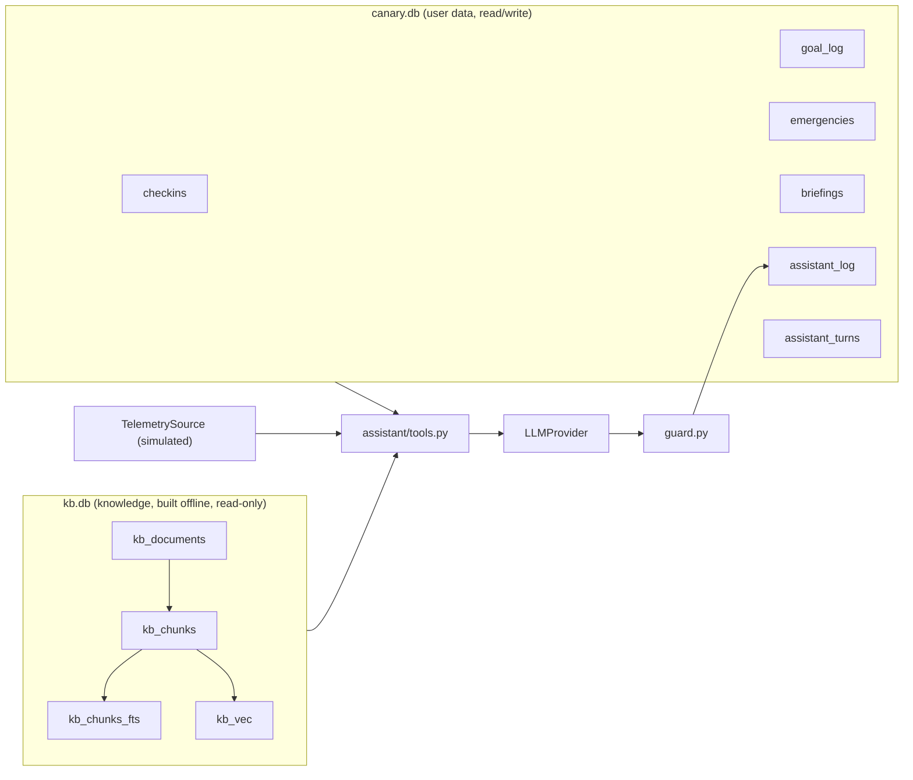
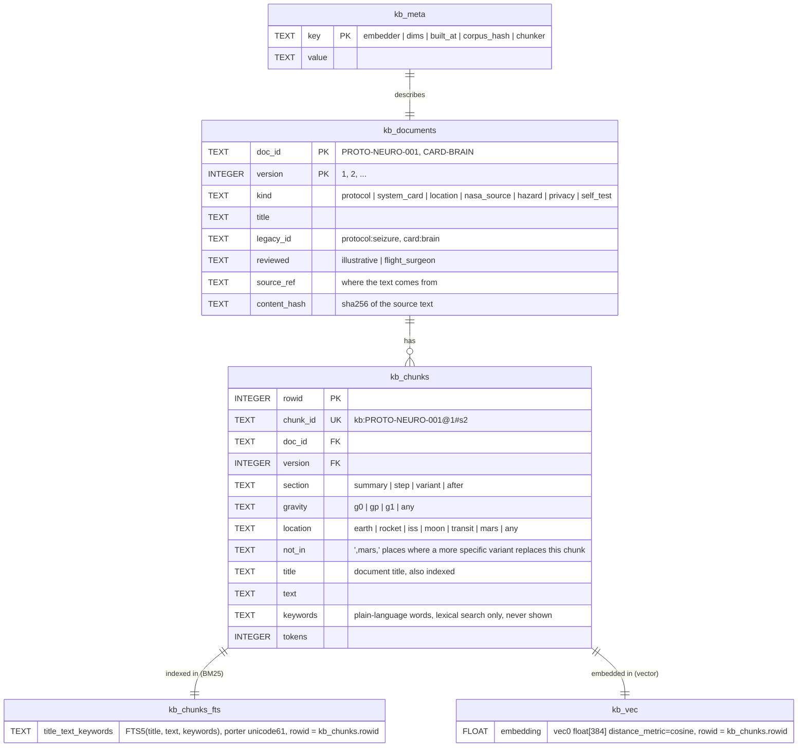

# Canary AI layer: data schema

Readable map of everything the AI layer stores, reads and returns. The code (`backend/canary/db.py`, `assistant/*.py`) must match this file; when one changes, update the other in the same change.

Legend: **existing** = in the code before the AI layer · **new** = added by [the plan](plan.md). Everything marked new is built (Waves 0 to 3); this file was reconciled with the code in Wave 3.

---

## 1. Overview



Two SQLite files on purpose:

| File | Who writes | Reset by `/api/demo/reset` | Why separate |
| --- | --- | --- | --- |
| `backend/canary.db` | the app, at runtime | yes | What people do on board |
| `backend/kb.db` | `make index`, at build time | no | Approved knowledge. Read-only at runtime, versioned, can be shipped as one file |

---

## 2. Source ids

Every fact the assistant may state carries a source id. The guard only accepts ids that a tool returned **in the same turn**.

| Prefix | Format | Example | Produced by | Status |
| --- | --- | --- | --- | --- |
| `telemetry` | `telemetry:{crew}:{indicator}:day{n}` | `telemetry:h:sleep:day147` | `health.indicator` | existing |
| `status` | `status:{crew}:day{n}` | `status:t:day2` | `tools.get_status` | existing |
| `goals` | `goals:{crew}:day{n}` | `goals:h:day147` | `tools.list_goals` | existing |
| `checkin` | `checkin:{crew}:{kind}:day{n}` | `checkin:a:amsler:day150` | `health.latest_checkin` | existing |
| `nasa` | `nasa:{dataset}:{key}` | `nasa:rad:2024-05-20` | `domain/nasa` | existing |
| `card` | `card:{system}` | `card:brain` | `tools.explain_system` | existing, legacy alias of `kb:CARD-*` (still returned) |
| `protocol` | `protocol:{pid}` | `protocol:seizure` | `tools.get_protocol` (`protocols.resolve`) | existing, legacy alias of `kb:PROTO-*` (still returned) |
| `kb` | `kb:{doc_id}@{version}#{chunk}` | `kb:PROTO-NEURO-001@1#s2` | `tools.search_knowledge` | **new** |
| `summary` | `summary:{crew}:day{n}:7d` | `summary:h:day147:7d` | `tools.get_weekly_summary` | **new** |

Rules:

- `kb:` ids are always versioned (`@1`), so an audit can tell which protocol text an answer used.
- `card:` and `protocol:` stay valid as aliases of the matching `kb:` document (`kb_map.json` `legacy`): `explain_system` and `get_protocol` still return them, the guard accepts them in `explanations`, and `source_meta` covers only `kb:` ids.
- An id the model writes that no tool returned is dropped, and the claim with it.
- `checkin` kinds are the 13 tests and logs of `domain/selftests.TESTS`: `pvt`, `dsst`, `span`, `mood`, `kss`, `tlx`, `wellbeing`, `vitals`, `amsler`, `symptoms`, `sleep`, `reading`, `journal`. A journal check-in stores only a line count, never the text. Alerts `wellbeing`, `sleepy` (KSS ≥ 7) and `symptoms` (severity ≥ 3) cite `checkin:` ids (`domain/health.py`).
- Knowledge document ids (§3) are `PROTO-*`, `CARD-*`, `LOC-*`, `NASA-*`, `HAZARD-{R,I,D,G,E}`, `PRIVACY-CONTRACT` and `TEST-{id}` (e.g. `kb:TEST-KSS@1#summary`).

---

## 3. Knowledge base (`kb.db`) · new



### Document ids

| Kind | Id pattern | Comes from | Example |
| --- | --- | --- | --- |
| Protocol | `PROTO-{AREA}-{NNN}` | `data/protocols.json` | `seizure` → `PROTO-NEURO-001` |
| System card | `CARD-{SYSTEM}` | `catalog.SYSTEMS` | `brain` → `CARD-BRAIN` |
| Place | `LOC-{PLACE}` | `catalog.LOCATIONS` | `mars` → `LOC-MARS` |
| NASA source | `NASA-{DATASET}` | `domain/nasa` sources | `NASA-DONKI` |
| Hazard | `HAZARD-{R,I,D,G,E}` | `privacy.RIDGE` + `RIDGE_LEVEL`, `privacy.HAZARD_BY_GRAVITY` | `G` → `HAZARD-G` (Gravity) |
| Privacy contract | `PRIVACY-CONTRACT` | `privacy.CONTRACT` (who sees what) and the `privacy.py` docstring | `PRIVACY-CONTRACT` |
| Self-test | `TEST-{ID}` | `selftests.TESTS` (one per test or log; scales KSS, NASA-TLX, PHQ-2 / GAD-2) | `kss` → `TEST-KSS` |

The legacy-to-new mapping lives in `backend/canary/data/kb_map.json` (one place, reviewed by hand):

```json
{ "protocol:seizure": "PROTO-NEURO-001", "protocol:cpr": "PROTO-CARDIO-001", "card:brain": "CARD-BRAIN" }
```

### Chunking

| Kind | Chunks |
| --- | --- |
| Protocol | `#summary` (name, sign, kit) · `#s{i}` one per step · `#s{i}-{gravity}` one per variant · `#after` |
| System card | `#summary` (what space does, hazard, indicators) |
| Place | `#summary` (gravity, delay, dose rate, what to expect) |
| NASA source | `#summary` (what the dataset is, what Canary uses) |
| Hazard | `#summary` (what it is, systems it affects) · `#{place}` level and "here" text per place |
| Privacy contract | `#summary` · one chunk per `CONTRACT` row |
| Self-test | `#summary` (what it measures, how long, what a high or low score means; never a diagnosis) |

Chunks are short (one step or one card) so a search result is a quotable unit, not a page.

### Search (`assistant/kb/`)

| File | Role |
| --- | --- |
| `kb/__init__.py` | `search(query, kind, k, gravity, place) -> list[Chunk]` (never raises; `[]` on any failure), `KINDS`, legacy-id lookup from `kb_map.json` |
| `kb/corpus.py` | builds every document and chunk from the domain modules and `kb_map.json` |
| `kb/build.py` | writes `kb.db` (`make index` = `python -m canary.assistant.kb.build`); reuses vectors whose text did not change |
| `kb/embed.py` | `local` embedder (fastembed `bge-small-en-v1.5`, 384 dims) or `none` |
| `kb/hybrid.py` | BM25 (FTS5) + cosine search, fused, filtered by gravity and place; builds `kb.db` on first use if it is missing |

Evidence floors: a match counts only with `-bm25 ≥ 2.0` or cosine `≥ 0.66`, and a lexical match needs at least one specific term (generic words such as *team*, *best*, *day* do not count alone, plan.md W1-3). With no embedder, or no sqlite-vec, search is BM25 only and still works offline.

The place and gravity filters read `mission.state()["location"]`, which follows the mission plan (`domain/plan.py`: `location_at(day)`, presets `mars` / `iss` / `moon`) unless a location override is set; gravity is `catalog.LOCATIONS[location]["gravity_key"]`.

---

## 4. User data (`canary.db`)

### Existing tables (unchanged)

| Table | Key columns | AI layer use |
| --- | --- | --- |
| `settings` | `key`, `value` (JSON) | see the keys below |
| `checkins` | `crew_id`, `day`, `kind`, `payload` | symptoms and self-checks for tools |
| `goal_log` | `crew_id`, `day`, `goal_id`, `done` | "what was tried" in briefings |
| `medical_goals` | `who`, `title`, `from_day`, `to_day` | goals set by the medical team |
| `messages` | `sender`, `recipient`, `kind`, `deliver_at` | queued briefings to Earth |
| `emergencies` | `protocol`, `patient`, `outcome`, `log` | briefing facts |
| `briefings` | `crew_id`, `day`, `status`, `facts`, `text`, `mode` | briefing drafts and approvals |

### `settings` keys

| Key | Written by | AI layer |
| --- | --- | --- |
| `thresholds` | `PUT /api/medical/thresholds` | read by `health` (alert levels) |
| `mission`, `setup_done` | `domain/mission.py` | read through `mission.state()` |
| `plan` | `domain/plan.py` | read through `plan.location_at(day)` / `mission.state()` |
| `suggested_goals` | `suggestions.accept` | read-only; reaches the model only as `sg_*` goals in `list_goals`; never returned by a tool |
| `pins` | `auth.set_pin` (hashed PINs) | never read, never returned |
| `photos` | `privacy.set_photo` | never read, never returned |

`/api/demo/reset` empties `settings` too: PINs go back to `CANARY_CREW_PINS`, the plan to the `mars` preset.

### `assistant_log` · existing, extended

| Column | Type | Status | Meaning |
| --- | --- | --- | --- |
| `id` | INTEGER PK | existing | |
| `crew_id` | TEXT | existing | who asked, bound by the server, never by the model |
| `question` | TEXT | existing | |
| `response` | TEXT (JSON) | existing | the `AssistantResponse` below |
| `created_at` | REAL | existing | |
| `provider` | TEXT | **new** | `none`, `anthropic`, `local` |
| `model` | TEXT | **new** | e.g. `claude-sonnet-5-5` |
| `kb_version` | TEXT | **new** | `kb_meta.corpus_hash` used to answer |
| `outcome` | TEXT | **new** | `ai`, `grounded`, `unknown`, `refused`, `emergency`, `fallback` |
| `guard_flags` | TEXT (JSON) | **new** | what the guard dropped or rejected, and why |
| `latency_ms` | INTEGER | **new** | |
| `input_tokens` / `output_tokens` | INTEGER | **new** | cost tracking |

### `assistant_turns` · new

One row per tool call, for audit and for the demo ("show me what Canary looked at").

| Column | Type | Meaning |
| --- | --- | --- |
| `id` | INTEGER PK | |
| `log_id` | INTEGER FK → `assistant_log.id` | |
| `step` | INTEGER | order in the loop |
| `tool` | TEXT | tool name |
| `args` | TEXT (JSON) | arguments the model sent (after validation) |
| `sources` | TEXT (JSON) | source ids the tool returned |
| `ok` | INTEGER | 0 when the tool returned an error |

---

## 5. Tools the model can call

`crew_id` is **not** a model argument. The server binds it to the person at the terminal, so the model can never read another astronaut's data.

**Visibility rule** (`domain/privacy.py`, `main.require_self`, `contracts.VISIBILITY`). Every call runs in a `ToolContext(crew_id, viewer, medical, mission)` built from the request after `require_self` passed: `viewer` is the signed-in astronaut (PIN token in `X-Canary-Viewer`) or `"medical"` (medical token in `Authorization: Bearer`). Tools return only the bound person's own data, to that person or the medical team. They never return another crew member's data, operational status, indicators or scores, and never crew averages. `wellbeing` check-ins (PHQ-2 / GAD-2) are mental-health data: self or medical only, never phrased as a diagnosis. `settings` keys `suggested_goals`, `pins`, `photos` are never returned.

| Tool | Arguments (JSON Schema, `strict: true`) | Returns | Status |
| --- | --- | --- | --- |
| `get_status` | `{}` | readiness scores, top 3 alerts | existing (drop `crew_id`) |
| `get_indicator` | `{ind: enum[sleep, react, mood, stress, social, hr, bp, temp, spo2, gluc, exer, water, grip, bone]}` | value, baseline, delta, level, 14-day trend | existing (drop `crew_id`) |
| `explain_system` | `{sys: enum[brain, eyes, heart, lungs, skeleton, muscles, gut, kidneys, immune, skin]}` | status, note, what space does | existing (drop `crew_id`) |
| `get_protocol` | `{pid: enum[cpr, seizure, choke, chest, allergy, bleed, eye, crisis, rad, triage]}` | name, sign, kit, first step (never the full flow) | existing |
| `list_goals` | `{}` | today's goals (`id`, `area`, `title`, `by`: routine · alert · medical · suggestion) and whether done; no XP, levels or points | existing (drop `crew_id`) |
| `get_checkins` | `{kind: enum[pvt, dsst, span, mood, kss, tlx, wellbeing, vitals, amsler, symptoms, sleep, reading, journal, any], days: integer 1..14}` | test and log history (journal: line count only) | **new** |
| `get_weekly_summary` | `{}` | 7-day means, trends and deltas computed by the backend (`briefing.facts`) | **new** |
| `search_knowledge` | `{query: string ≤200, kind: enum[protocol, system_card, location, nasa_source, hazard, privacy, self_test, any], k: integer 1..6}` | chunks `{chunk_id, title, text, score}`, filtered to the current gravity and place | **new** |

Every tool result has the same envelope:

```json
{ "data": { }, "sources": ["telemetry:h:sleep:day147"], "error": null }
```

---

## 6. Final answer: `AssistantResponse` · new

Requested from the model with structured output (`output_config.format`, JSON Schema). The backend validates it again before showing it.

```json
{
  "status": "supported",
  "answer": "Your sleep is 1.3 h below your normal this week.",
  "observations": [
    { "statement": "Sleep 6.1 h, normal 7.4 h", "source_ids": ["telemetry:h:sleep:day147"] }
  ],
  "explanations": [
    { "statement": "Isolation and shifted light cycles commonly erode sleep on long missions.", "source_ids": ["kb:CARD-BRAIN@1#summary"] }
  ],
  "limitations": ["The data does not show the cause of the change."],
  "recommended_action_id": "goal:al_light"
}
```

| Field | Type | Rule enforced by `guard.py` |
| --- | --- | --- |
| `status` | `supported` · `insufficient_evidence` · `out_of_scope` | `supported` needs at least one valid observation |
| `answer` | string ≤ 600 chars | no dose, no diagnosis wording; every number must appear in tool results |
| `observations[]` | `{statement, source_ids[≥1]}` | **facts from data**: ids must be `telemetry`, `status`, `checkin`, `goals`, `summary`, `nasa`; numbers checked |
| `explanations[]` | `{statement, source_ids[≥1]}` | **possible explanations**: ids must be `kb:` (or legacy `card:` / `protocol:`) |
| `limitations[]` | string[] | required (may be empty only when `status = supported` and nothing is missing) |
| `recommended_action_id` | string or null | must be in the allow-list below |

Allowed actions (the model picks one, it never invents one):

| Id pattern | Meaning |
| --- | --- |
| `goal:{goal_id}` | a goal already in today's list: routine (`goal:water`), alert (`goal:al_light`), medical (`goal:med_3`) or accepted suggestion (`goal:sg_nap`) |
| `protocol:{pid}` | open Guided Response for that protocol |
| `contact_cmo` | talk to the crew medical officer |
| `send_briefing` | prepare a message to the flight surgeon |
| `null` | no action |

### What the API returns to the frontend

`POST /api/assistant/ask` keeps the current keys (so `AskCanary.tsx` keeps working) and adds the new ones:

| Key | Status | Meaning |
| --- | --- | --- |
| `mode` | existing | `ai`, `grounded`, `unknown`, `refused`, `emergency`, `fallback` (new value) |
| `answer`, `claims`, `sources`, `tools_used`, `dropped`, `provider`, `provider_error`, `id` | existing | `claims` = observations + explanations that survived the guard |
| `status`, `observations`, `explanations`, `limitations`, `recommended_action` | **new** | from `AssistantResponse`; `recommended_action` is resolved to `{id, label}` |
| `guard` | **new** | `{dropped_claims: [{field, statement, rule_id}], rejected_numbers: string[], reason, rule_ids: string[]}` for the reliability demo; `reason` is a rule id (precheck), a postcheck reason, or a loop/API exit such as `loop:max_steps: …` |
| `model`, `prompt_version` | **new** | model id that answered (null without a provider) and the system prompt version (`system_v1`) |
| `source_meta` | **new** | `{kb id: {title, version (int), text}}` for every `kb:` id `search_knowledge` returned this turn and the answer cites |

`mode` values: `ai` (model answer that passed postcheck) · `grounded` (no provider set, or the provider is not configured: rule answer from `route()`) · `fallback` (a set provider failed, hit a loop guard, or its answer failed postcheck: rule answer from `route()`) · `unknown` (no provider and `route()` found nothing) · `refused` / `emergency` (precheck, no model call).

### Guard flags (`assistant_log.guard_flags`, audit `guard_flags`)

Rule ids from `data/guard_rules.json` (`G-DOSE-02`, `G-SRC-01`, `G-NUM-01`, `G-PRIV-01`, `G-ACT-01`…) plus the loop and API exits of `providers.GUARD_EXITS`:

| Flag | Ends the loop | Meaning |
| --- | --- | --- |
| `loop:max_steps` | yes | more than `CANARY_LLM_MAX_STEPS` model rounds needed |
| `loop:timeout` | yes | the question's deadline passed before a round |
| `loop:max_tool_calls` | no | the tool budget was used up; later calls got an `is_error` result and the loop went on |
| `loop:repeat` | no | a repeated call (same tool and arguments) got the cached result plus a note |
| `model:refusal`, `model:max_tokens`, `model:bad_output` | yes | stop reason or unparsable JSON |
| `api:timeout`, `api:rate_limit`, `api:connection`, `api:status`, `api:error` | yes | SDK errors (no SDK retries) |

### Audit route

`GET /api/medical/assistant-audit?limit=30` (medical token, `limit` 1..200) returns `AssistantAuditEntry[]`, newest first: `{id, crew_id, question, created_at, mode, status, provider, model, kb_version, tools: string[], guard_flags: string[], latency_ms}`. No answer text. `tools` comes from `assistant_turns`, or from the rule path's `tools_used` when no model ran.

### AI entries

| Entry (`ProviderRequest.task`) | Route | Tools | Output | Check |
| --- | --- | --- | --- | --- |
| `chat` | `POST /api/assistant/ask` (`require_self`) → `chat.ask(crew_id, question, viewer=main.viewer())` | yes | `AssistantResponse` | `guard.postcheck` |
| `briefing` | `POST /api/briefings` (`require_self`) | no | `BriefingDraft` (§7) | numbers in `facts`, sources |
| `suggestions` | `GET /api/suggestions/{crew_id}` (astronaut only, not medical) | no | JSON list `[{id, why}]` rephrasing each `why` | `guard.unknown_numbers(text, facts_blob)`; on failure the rule text stays |

---

## 7. Briefing output: `BriefingDraft` · new

The model only rewrites computed facts as prose. Same rules: numbers must exist in `facts`, every line cites.

```json
{
  "sections": [
    { "heading": "What worries", "lines": [{ "text": "Sleep, mood and focus dropping together.", "source_ids": ["telemetry:h:sleep:day147"] }] },
    { "heading": "What changed", "lines": [] },
    { "heading": "What was tried", "lines": [] }
  ],
  "missing_information": ["No blood pressure reading in the last 3 days."],
  "needs_medical_review": ["Reaction time 2.6 sigma above normal."]
}
```

Sections stay in priority order, so the first lines are enough on a slow link. If validation fails, the existing `briefing.template()` text is used (`mode = "template"`).
